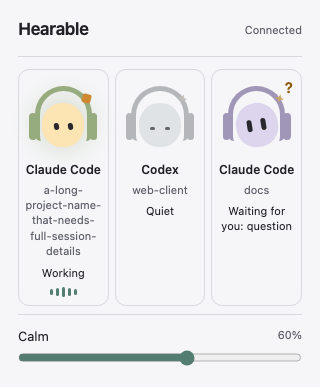
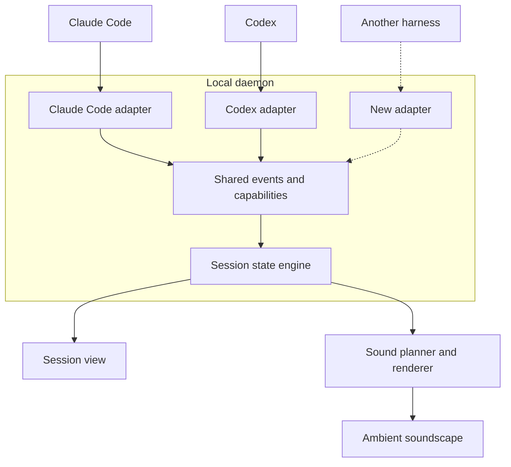

<p align="center">
  
</p>

<h1 align="center">Hearable Agents</h1>

<p align="center">
  <strong>Keep an ear on your coding agents.</strong><br>
  Hear their live activity as an evolving ambient soundscape.
</p>

Hearable is a small Mac menu bar app (currently) that lets you hear what your coding agents are doing.
It plays quiet ambient music that reflects their current status, and cues you when an agent
needs you or finishes. It lets you have awareness on your agent without checking on them, so you can better focus on the rest of your work.

<p align="center">
  
</p>

## What it actually does

Hearable builds the soundscape from the events your coding sessions produce. Each harness
connects through an adapter that translates events like tool starts, permission requests,
and turn endings into a shared format. The adapter also declares which signals its harness
can report, so the same state engine can handle different harnesses based on the evidence
each one provides.



The state engine uses recent events and their timing to track how active each session is,
what kind of work it’s doing, and whether it needs input. An explicit permission request
can change the state immediately. A stretch of silence gradually lowers the session’s
activity level.

Activity determines how far forward a session sits in the mix. Exploring, editing, and
testing shift the blend of airy textures, grain, and pulse. The renderer fades between
those settings and plays chords made from recorded piano notes at specific transitions.
Sessions share a harmonic palette, so their sounds can change independently and still
fit together as one piece.

## Try it

[Download Hearable for Apple Silicon](https://github.com/rankrausz/hearable-agents/releases/download/v0.1.1/Hearable-0.1.1-macos-arm64.dmg) (macOS 13 or later).
Install Claude Code or Codex before connecting it to Hearable.

1. Open the DMG, drag **Hearable** into **Applications**, and launch it from there.
2. From the menu bar, choose **Connect an agent**, then select **Claude Code** or **Codex**
   to install its hooks.
3. Turn on **Audio** and start a new session in the agent you connected. If Codex asks you
   to trust the hooks, review them in `/hooks`.

The app bundles everything Hearable needs for setup. Apple hasn’t notarized this preview,
so macOS may block the first launch. After trying to open Hearable, go to
**System Settings → Privacy & Security** and click **Open Anyway** for Hearable.

### Run from source

You’ll need Node **22.12+** and pnpm **11.25.0**. From the repository root:

```sh
pnpm install --frozen-lockfile
pnpm mac
```

Use the [source hook installer](docs/GETTING_STARTED.md#agent-hooks) to connect an agent
when running from source.

See [Getting started](docs/GETTING_STARTED.md) for fixture replay, standalone builds, and troubleshooting.
See [privacy and recording](docs/PRIVACY.md) for what Hearable processes and stores locally.

Code is [MIT licensed](LICENSE). The bundled recordings (piano samples and the rain bed) have
their own [licenses and attribution](packages/audio/src/scenes/clearing/ASSETS.md).
