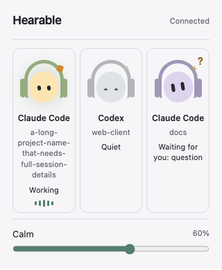
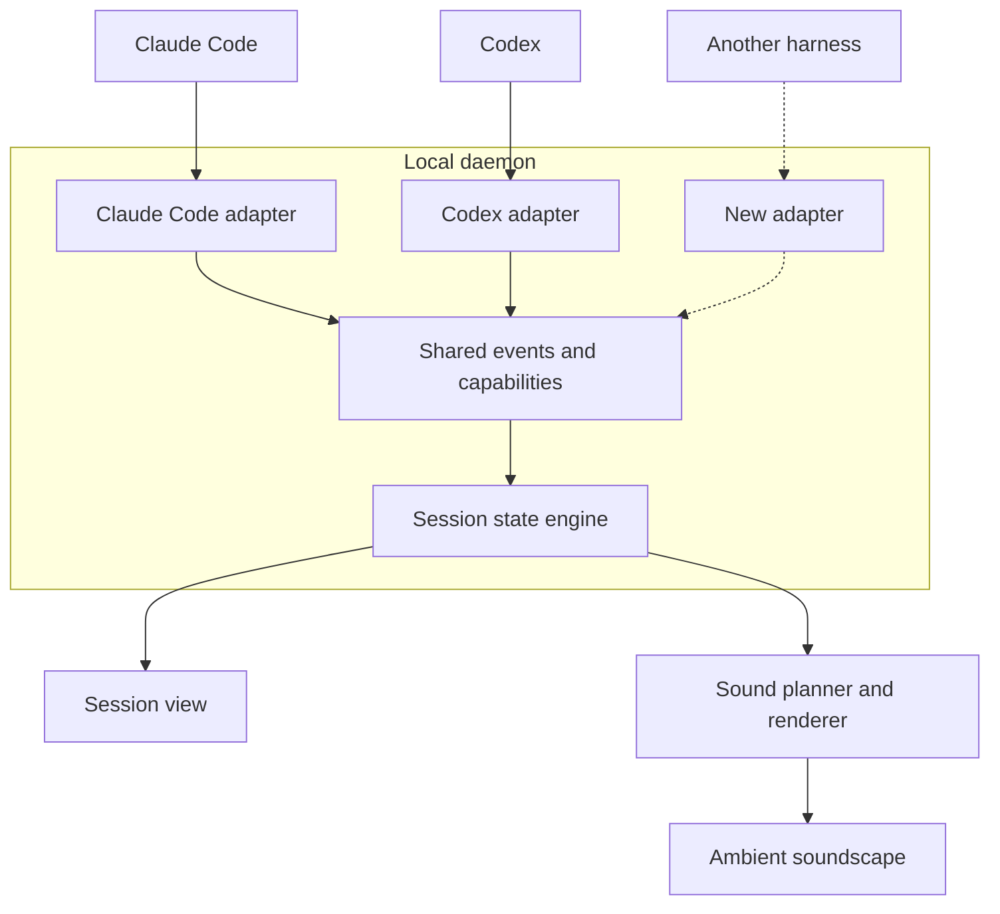

<p align="center">
  
</p>

<h1 align="center">Hearable Agents</h1>

<p align="center">
  <strong>Keep an ear on your coding agents.</strong><br>
  Hear their live activity as an evolving ambient soundscape.
</p>

Hearable is a small Mac menu bar app (currently) that lets you hear what your coding agents are doing.
It plays quiet ambient music that reflects their current status, and cues you when an agent
needs you or finishes. It lets you have awareness on your agent without checking on them, so you can better focus on the rest of your work.

<p align="center">
  
</p>

## What it actually does

Hearable builds the soundscape from the events your coding sessions produce. Each harness
connects through an adapter that translates events like tool starts, permission requests,
and turn endings into a shared format. The adapter also declares which signals its harness
can report, so the same state engine can handle different harnesses based on the evidence
each one provides.



The state engine uses recent events and their timing to track how active each session is,
what kind of work it’s doing, and whether it needs input. An explicit permission request
can change the state immediately. A stretch of silence gradually lowers the session’s
activity level.

Activity determines how far forward a session sits in the mix. Exploring, editing, and
testing shift the blend of airy textures, grain, and pulse. The renderer fades between
those settings and plays chords made from recorded piano notes at specific transitions.
Sessions share a harmonic palette, so their sounds can change independently and still
fit together as one piece.

## Try it

This is an early macOS preview. You’ll need Node **22.12+** and pnpm **11.25.0**.
From the repository root, install dependencies and start Hearable.

```sh
pnpm install --frozen-lockfile
pnpm mac
```

Open Hearable from the menu bar and turn on audio. In a second terminal at the repository
root, run the hook installer.

```sh
pnpm --filter @hearable/cli hearable install
```

The installer detects Claude Code and Codex on your `PATH` and asks before updating their
local hook configuration. If Codex prompts you to trust the hooks, review them in `/hooks`.
Start a new session in the agent you connected to hear it in the mix.

See [Getting started](docs/GETTING_STARTED.md) for fixture replay, standalone builds, and troubleshooting.
See [privacy and recording](docs/PRIVACY.md) for what Hearable processes and stores locally.

Code is [MIT licensed](LICENSE). The bundled recordings (piano samples and the rain bed) have
their own [licenses and attribution](packages/audio/src/scenes/clearing/ASSETS.md).
